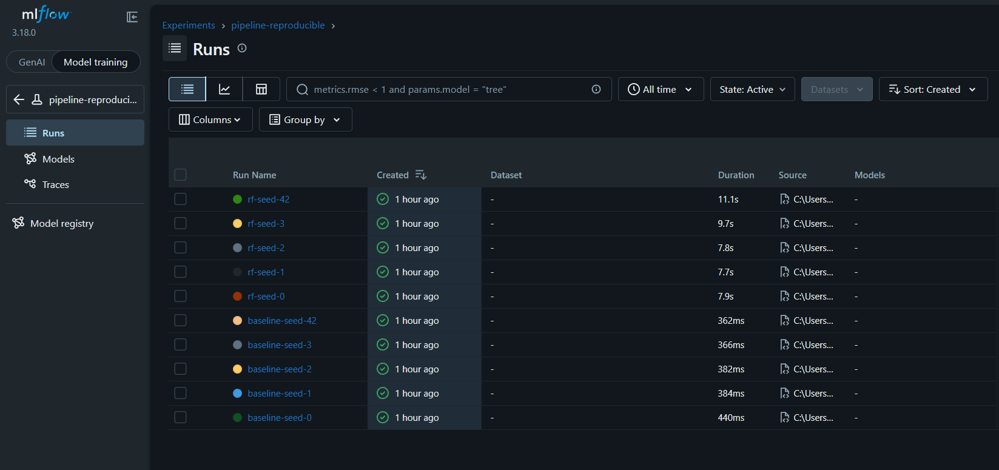

# Pipeline de ML reproducible · Predicción de deserción estudiantil

Machine Learning I · Proyecto Integrador · Entregable individual

Alumno(a): Adrian Feria Lezama · Grupo: 1 · Algoritmo asignado: Random Forest

# Resumen:
Este proyecto utiliza un modelo Random Forest para predecir la deserción estudiantil mediante el dataset DadosV3, compuesto por 14,942 registros y 47 columnas. La variable objetivo es `Dropout`.

Fuente del dataset: DadosV3.csv.

## Entorno de ejecución

- **Python:** 3.13.5
- **Sistema operativo:** Microsoft Windows 11 Home
- **Entorno virtual:** venv (`.venv`)

### Dependencias principales

Las versiones exactas están registradas en `requirements.txt`:

- `numpy==2.5.4`
- `pandas==3.1.1`
- `scikit-learn==1.9.1`
- `mlflow==3.18.0`

macOS / Linux:
```bash
git clone https://github.com/AdriandFC/repro-ml-feria repro && cd repro
python -m venv .venv && source .venv/bin/activate
pip install -r requirements.txt
PYTHONHASHSEED=0 python -m src.prepare_data
PYTHONHASHSEED=0 python -m src.train --seed 42
PYTHONHASHSEED=0 python -m src.run_seeds
```
Windows (PowerShell):
```powershell
git clone https://github.com/AdriandFC/repro-ml-feria repro; cd repro
python -m venv .venv; .venv\Scripts\Activate.ps1
pip install -r requirements.txt
$env:PYTHONHASHSEED=0
python -m src.prepare_data
python -m src.train --seed 42
python -m src.run_seeds
```

## Resultado esperado
Una corrida (`--seed 42`):
{"seed": 42, "modelo": "rf", "data_md5": "7f668c20ebe1f8c985985f86c7546db8", "accuracy_mean": 0.92379, "accuracy_sd": 0.00703, "f1_macro_mean": 0.87079, "f1_macro_sd": 0.01246, "recall_macro_mean": 0.84438, "recall_macro_sd": 0.01428}

### Resultados de cinco semillas

Los resultados completos se encuentran en `results/results_summary.csv`.

| Semilla | Modelo | Accuracy media | Accuracy DE | F1 macro media | F1 macro DE | Recall macro media | Recall macro DE |
|---:|---|---:|---:|---:|---:|---:|---:|
| 0 | baseline | 0.80097 | 0.00016 | 0.44474 | 0.00005 | 0.50000 | 0.00000 |
| 1 | baseline | 0.80097 | 0.00016 | 0.44474 | 0.00005 | 0.50000 | 0.00000 |
| 2 | baseline | 0.80097 | 0.00016 | 0.44474 | 0.00005 | 0.50000 | 0.00000 |
| 3 | baseline | 0.80097 | 0.00016 | 0.44474 | 0.00005 | 0.50000 | 0.00000 |
| 42 | baseline | 0.80097 | 0.00016 | 0.44474 | 0.00005 | 0.50000 | 0.00000 |
| 0 | rf | 0.92496 | 0.00645 | 0.87351 | 0.01115 | 0.84860 | 0.01165 |
| 1 | rf | 0.92278 | 0.00484 | 0.86940 | 0.00817 | 0.84360 | 0.00758 |
| 2 | rf | 0.92496 | 0.00381 | 0.87302 | 0.00789 | 0.84717 | 0.01211 |
| 3 | rf | 0.92404 | 0.00677 | 0.87172 | 0.01207 | 0.84645 | 0.01324 |
| 42 | rf | 0.92379 | 0.00703 | 0.87079 | 0.01246 | 0.84438 | 0.01428 |

**Resultado entre cinco semillas:** Random Forest obtuvo un Accuracy de **0.9241 ± 0.0009**. El modelo baseline obtuvo **0.8010 ± 0.0000**. Los valores corresponden a la media ± desviación estándar muestral entre las cinco semillas.

### Resultado de validación cruzada (semilla 42)

Accuracy = 0.92379 ± 0.00703, F1 macro = 0.87079 ± 0.01246 y Recall macro = 0.84438 ± 0.01428, calculados mediante validación cruzada de 5 particiones.



## Estructura de datos (data lake)

El proyecto organiza los datos en tres zonas:

| Zona | Carpeta | Contenido | Regla |
|---|---|---|---|
| raw (bronze) | `data/raw/` | Dataset original | Nunca se edita |
| processed (silver) | `data/processed/` | Datos preparados para el entrenamiento | Se regenera con `src.prepare_data` |
| results (gold) | `results/` | Métricas de los experimentos | Se regenera con `src.run_seeds` |

La información sobre el dataset, su formato y sus características se documenta en `data/MANIFIESTO.md`.

## Qué lo hace reproducible

| Requisito | Cómo se cumple |
|---|---|
| ≥ 6 commits | El desarrollo se registra mediante commits en Git. |
| Sin fuga de datos | El preprocesamiento se realiza dentro de pipelines de scikit-learn. |
| Aleatoriedad fija | Se utilizan semillas configuradas y `PYTHONHASHSEED=0`. |
| 5 semillas en MLflow | Se registran experimentos con las semillas 0, 1, 2, 3 y 42. |
| Mismos datos para todos | Se registra el hash MD5 del dataset procesado. |
| Entorno exacto | Las versiones de las dependencias están fijadas en `requirements.txt`. |

## Prueba del extraño

- **Persona que realizó la prueba:** [Nombre del compañero]
- **Grupo:** [Grupo del compañero]
- **Issue:** [Enlace al Issue de GitHub]
- **Resultado:** [Indicar si pudo clonar el repositorio, instalar las dependencias y ejecutar el pipeline correctamente].

## Limitaciones

- El rendimiento del modelo depende de la calidad y representatividad del dataset utilizado.
- El dataset presenta un desbalance entre las clases de la variable objetivo `Dropout`.
- Las métricas obtenidas corresponden a los datos disponibles y no garantizan el mismo rendimiento con datos nuevos.
- El modelo Random Forest no demuestra por sí solo relaciones causales entre las características y la deserción estudiantil.

## Respuestas
1. …
2. …
3. …
4. …
5. …
6. …

## Declaración de uso de IA

Se utilizó ChatGPT como herramienta de apoyo para comprender los pasos del proyecto, resolver dudas sobre Python, Git, scikit-learn y MLflow, y mejorar la documentación del README.

El autor revisó las instrucciones, ejecutó los comandos en su entorno local, verificó los resultados obtenidos y realizó los cambios correspondientes en el repositorio.
